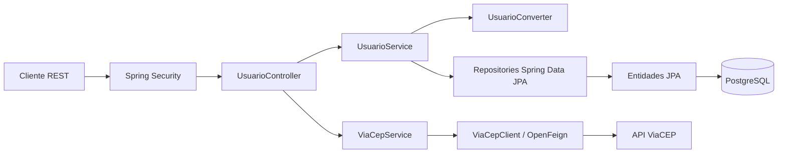
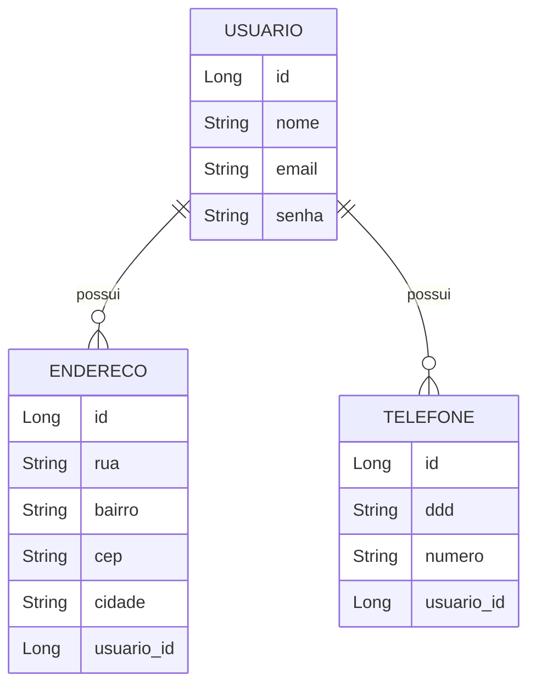

# API de Gerenciamento de Usuários

API REST para cadastro e gerenciamento de usuários, endereços e telefones. O projeto também oferece autenticação stateless com JWT e consulta de endereços por CEP usando o serviço ViaCEP.

O repositório é um projeto de portfólio construído com Java e Spring Boot, organizado em camadas para separar os endpoints HTTP, as regras de negócio e o acesso a dados.

## Destaques

- API REST com operações de cadastro, consulta, atualização e remoção de usuários.
- Autenticação com Spring Security, tokens JWT e senhas armazenadas com BCrypt.
- Persistência relacional com Spring Data JPA e PostgreSQL.
- Integração HTTP com o ViaCEP por meio do Spring Cloud OpenFeign.
- Tratamento centralizado de erros e respostas HTTP coerentes.
- Build e pipeline de integração contínua com Gradle e GitHub Actions.
- Imagem Docker com estágio de build separado do estágio de execução.

## Tecnologias

| Tecnologia | Uso |
| --- | --- |
| Java 21 | Linguagem e runtime |
| Spring Boot | Aplicação web e configuração |
| Spring MVC | Endpoints REST |
| Spring Security | Autenticação e autorização |
| JJWT | Geração e validação de tokens JWT |
| Spring Data JPA / Hibernate | Persistência e ORM |
| PostgreSQL | Banco de dados relacional |
| Spring Cloud OpenFeign | Cliente para integração com ViaCEP |
| Gradle | Build e execução de testes |
| Docker | Empacotamento da aplicação |
| GitHub Actions | Build em pull requests para `master` |

## Arquitetura

A aplicação segue uma organização em camadas: o controller recebe as requisições, os serviços executam as regras de negócio, os repositórios acessam o banco e os conversores isolam o mapeamento entre entidades e DTOs. A integração com o ViaCEP é feita por um cliente Feign dedicado.



### Organização do código

```text
src/main/java/com/projeto/usuario/usuario/
├── UsuarioApplication.java
├── controller/                 # Endpoints HTTP
├── business/
│   ├── UsuarioService.java     # Regras de negócio de usuários
│   ├── ViaCepService.java      # Validação do CEP e consulta externa
│   ├── converter/              # Conversão entre DTOs e entidades
│   └── dto/                    # Contratos de entrada e saída
├── exception/                  # Exceções de domínio
└── infraestructure/
    ├── client/                 # Cliente HTTP ViaCEP
    ├── entity/                 # Entidades JPA
    ├── handler/                # Tratamento global de erros
    ├── repository/             # Repositórios Spring Data
    └── security/               # JWT, filtro e configuração de segurança
```

### Modelo de dados

Um usuário pode ter vários endereços e telefones. As entidades `Endereco` e `Telefone` mantêm a referência ao usuário, e o relacionamento é persistido com JPA.



## Endpoints

Os endpoints abaixo usam a base `/usuarios`. As rotas de cadastro de usuário, login e consulta ViaCEP são públicas; as demais rotas de usuários exigem o header `Authorization: Bearer <token>`.

| Método | Rota | Acesso | Descrição |
| --- | --- | --- | --- |
| `POST` | `/usuarios` | Público | Cadastra usuário |
| `POST` | `/usuarios/login` | Público | Autentica e retorna um JWT |
| `GET` | `/usuarios/{id}` | JWT | Busca usuário pelo identificador |
| `GET` | `/usuarios?email={email}` | JWT | Busca usuário pelo e-mail |
| `PUT` | `/usuarios/{id}` | JWT | Atualiza dados do usuário |
| `DELETE` | `/usuarios/{id}` | JWT | Remove usuário |
| `POST` | `/usuarios/enderecos` | JWT | Cadastra endereço para o usuário autenticado |
| `PUT` | `/usuarios/enderecos/{id}` | JWT | Atualiza endereço |
| `POST` | `/usuarios/telefones` | JWT | Cadastra telefone para o usuário autenticado |
| `PUT` | `/usuarios/telefones/{id}` | JWT | Atualiza telefone |
| `GET` | `/usuarios/enderecos/cep?cep={cep}` | Público | Consulta dados de um CEP no ViaCEP |

As atualizações aceitam campos opcionais: os campos omitidos permanecem inalterados. A API responde com `409 Conflict` para e-mail já cadastrado, `404 Not Found` para recursos inexistentes, `401 Unauthorized` para falhas de autenticação e `400 Bad Request` para CEP inválido.

### Exemplo de cadastro

```http
POST /usuarios
Content-Type: application/json
```

```json
{
  "nome": "Ana Silva",
  "email": "ana@example.com",
  "senha": "uma-senha-segura",
  "enderecos": [
    {
      "rua": "Rua das Flores",
      "bairro": "Centro",
      "cep": "01001-000",
      "cidade": "São Paulo"
    }
  ],
  "telefones": [
    {
      "ddd": "11",
      "numero": "999999999"
    }
  ]
}
```

### Exemplo de autenticação

```http
POST /usuarios/login
Content-Type: application/json
```

```json
{
  "email": "ana@example.com",
  "senha": "uma-senha-segura"
}
```

Use o token retornado no header das rotas protegidas:

```http
Authorization: Bearer <token>
```

## Autor do Projeto
- [Arthur Rodrigues](https://www.linkedin.com/in/arthur-rodriguesx/)